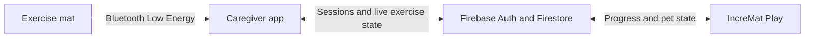

# IncreMat Caregiver

A Flutter app that helps caregivers follow an older adult's sit-to-stand exercise: live repetitions, session history, progress charts, and reminders. It is the monitoring component of **IncreMat**, a smart exercise mat project developed through **RC4 STEER Shenzhen 2026**.

**Companion:** [IncreMat Play](https://github.com/chuayawen/incremat-play), the senior-facing app that turns exercise progress into virtual-pet growth.

## How the apps fit together



The caregiver app receives the mat's running repetition count, attributes sessions to the selected person, and publishes exercise data to Firestore. The public Play app reads the shared data to show progress and award pet growth.

## What the app does

- **Caregiver coordination:** sign in, manage senior profiles, and link caregivers through join codes.
- **Live exercise tracking:** connect to the mat over BLE, track repetitions and pace, and identify users through NFC.
- **Progress review:** view activity charts and session history, run a timed chair-stand assessment, and export a PDF report.
- **Exercise feedback:** build up layers of music as repetitions increase, with spoken count encouragement.
- **Accessible communication:** English and Chinese interfaces, in-app mobility trend alerts, and reminder settings.
- **Hardware-free development:** switch to an interactive mat simulator to exercise connection, repetition-count, and NFC flows.

## Engineering highlights

| Problem | Implementation | Start here |
| --- | --- | --- |
| A mat's cumulative count must become a person's session count | A baseline-based segmenter handles reconnects, counter resets, and user switches | [RepSegmenter](lib/core/utils/rep_segmenter.dart) and [its tests](test/rep_segmenter_test.dart) |
| Hardware should not be required for every development check | A shared hardware interface has BLE and simulator implementations, selected through Riverpod | [Hardware interface](lib/services/hardware/hardware_service.dart) and [provider wiring](lib/providers/hardware_provider.dart) |
| One mat can be used by several people | An NFC coordinator resolves identities and imports buffered offline sessions | [NFC coordinator](lib/providers/nfc_identity_provider.dart) |
| The second app needs live exercise feedback | Live session state is mirrored to Firestore alongside saved history | [Live session provider](lib/providers/live_session_provider.dart) |

## Code tour

```text
lib/
  core/           Shared theme, constants, and exercise utilities
  features/       Screens for home, hardware, seniors, insights, and reports
  models/         Senior, session, and sync data
  providers/      Riverpod state and session coordination
  services/       Hardware, NFC, persistence, notifications, and sync
  l10n/           English and Chinese strings
test/             Exercise logic and simulator widget tests
functions/        Scheduled reminder function source
```

For a short review, follow **[rep segmentation](lib/core/utils/rep_segmenter.dart) → [session coordination](lib/providers/live_session_provider.dart) → [progress charts](lib/features/insights/insights_screen.dart)**. The matching [tests](test/) show several of the edge cases the app handles.

## Run locally

### Requirements

- Flutter with **Dart 3.12 or later within Dart 3**, matching [pubspec.yaml](pubspec.yaml).
- An Android device or emulator for the mobile app; a physical device and compatible mat for BLE/NFC checks.
- A Firebase development project you control. The two apps must use the same backend for shared exercise data.

```bash
git clone https://github.com/chuayawen/incremat.git
cd incremat
flutter pub get
```

Configure Firebase before launching:

1. Follow the [Firebase Flutter setup guide](https://firebase.google.com/docs/flutter/setup) to register your Android app and generate configuration for your own project. This app reads `lib/firebase_options.dart` at startup.
2. Enable **Email/Password** authentication for caregivers. Enable **Anonymous** authentication as well if connecting the Play app.
3. Configure Firestore for the shared senior, caregiver-access, and session data. The companion app includes [Firestore rules](https://github.com/chuayawen/incremat-play/blob/main/src/incremat_play/firestore.rules) for the prototype's shared model.
4. Use test profiles in your development project; bundled configuration identifies the original project and does not grant access to it.

Then start the app:

```bash
flutter run
```

### Try the exercise flow without a mat

After signing in to your development backend and adding a test senior, open **Settings → Developer · Simulator**, enable **Simulator mode**, and use the repetition and connection controls. This replaces the BLE service with a simulator; Firebase setup is still required for account and session persistence.

## Checks and project status

```bash
flutter analyze
flutter test
```

The test suite includes repetition segmentation, chair-stand calculations, mobility-alert logic, and simulator widget interactions. Use the normal test asset bundle for the widget tests. The separate placeholder widget test is not evidence of end-to-end coverage.

This is a **student prototype**. Physical-mat behaviour and the complete two-app workflow require device testing in addition to unit tests. Scheduled reminder source is included under [`functions/`](functions/README.md); its presence does not imply that the functions have been deployed.
